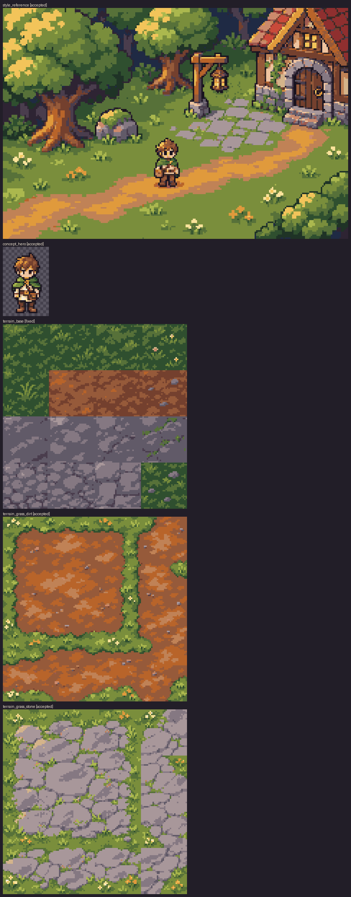

# Batch 01 intake report: Style foundation

Generated by `make art-intake BATCH=01`. Do not edit by hand; re-run intake.
Hand-drawn assets (with a `source:`) are not listed; see report.md.

Summary: 4 accepted, 1 fixed

| Asset | Status | Source | Grid (px per art pixel) | Cells | Quantized | Notes |
|---|---|---|---|---|---|---|
| `style_reference` | accepted | 01-01-style_reference-a4.png | 6.40 × 6.40 | 240×160 | 38398 px (max Δ 0.105) |  |
| `concept_hero` | accepted | 01-02-concept_hero-a4.png | 20.31 × 19.57 | 51×79 | 637 px (max Δ 0.072) | trimmed margin 19×31 |
| `terrain_base` | fixed | exec-36d2db21-f88c-4b34-8fe8-fce5b01f13db.png | 9.80 × 9.80 | 128×128 | 16384 px (max Δ 0.068) |  |
| `terrain_grass_dirt` | accepted | 01-04-terrain_grass_dirt-a6.png | 9.80 × 9.80 | 128×128 | 16383 px (max Δ 0.070) |  |
| `terrain_grass_stone` | accepted | 01-05-terrain_grass_stone-a6.png | 9.80 × 9.80 | 128×128 | 16384 px (max Δ 0.078) |  |

Inbox files not in map.yaml: `01-01-style_reference-a2.png`, `01-01-style_reference-a3.png`, `01-02-concept_hero-a2.png`, `01-02-concept_hero-a3.png`, `01-04-terrain_grass_dirt-a2.png`, `01-04-terrain_grass_dirt-a3.png`, `01-04-terrain_grass_dirt-a4.png`, `01-04-terrain_grass_dirt-a5.png`, `01-05-terrain_grass_stone-a2.png`, `01-05-terrain_grass_stone-a3.png`, `01-05-terrain_grass_stone-a4.png`, `01-05-terrain_grass_stone-a5.png`, `exec-00a2f1e3-a65d-41f3-b4ff-56ff944a90c4.png`, `exec-6450b6c4-f32a-48ec-90ac-bcef95587132.png`, `exec-83f6baf4-e1f9-4320-a02d-67aec7327fee.png`, `exec-cb2910b4-7ab7-4101-a659-8d586b643088.png`

