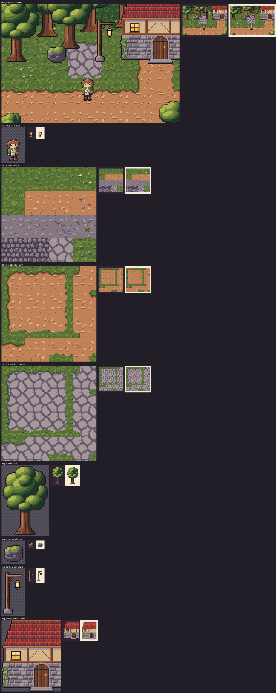

# Batch 01 report: Style foundation

Generated by `make art-draw BATCH=01`. Do not edit by hand.
Hand-drawn assets are rendered from `art/src/`; generated ones come from
intake (`intake-report.md` has their details, when there are any).

Summary: 9 drawn

| Asset | Kind | Size | Source | Status | Problems |
|---|---|---|---|---|---|
| `style_reference` | ui | 240×160 | `art/src/style/reference.py` | drawn |  |
| `concept_hero` | sprite | 32×48 | `art/src/chars/concept_hero.pxl.yaml` | drawn |  |
| `terrain_base` | tileset | 128×128 | `art/src/tiles/terrain_base.py` | drawn |  |
| `terrain_grass_dirt` | tileset | 128×128 | `art/src/tiles/terrain_grass_dirt.py` | drawn |  |
| `terrain_grass_stone` | tileset | 128×128 | `art/src/tiles/terrain_grass_stone.py` | drawn |  |
| `prop_tree` | sprite | 64×96 | `art/src/props/tree_oak.py` | drawn |  |
| `prop_mossy_rock` | sprite | 32×32 | `art/src/props/mossy_rock.py` | drawn |  |
| `prop_lantern_post` | sprite | 32×64 | `art/src/props/lantern_post.py` | drawn |  |
| `prop_cottage_corner` | sprite | 80×96 | `art/src/props/cottage_corner.py` | drawn |  |

Contact sheets: [4x, every asset](preview.png) and [8x, hand-drawn](preview-8x.png).
Each asset is also shown at 1x on dark and light backgrounds.

