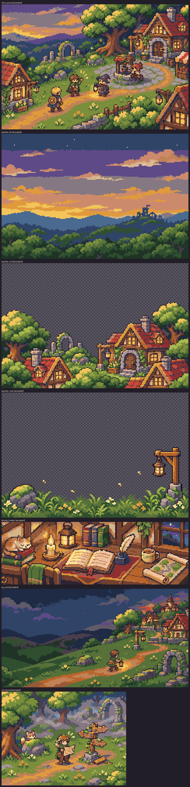

# Batch 02 intake report: Brand and website art

Generated by `make art-intake BATCH=02`. Do not edit by hand; re-run intake.
Hand-drawn assets (with a `source:`) are not listed; see report.md.

Summary: 7 accepted

| Asset | Status | Source | Grid (px per art pixel) | Cells | Quantized | Notes |
|---|---|---|---|---|---|---|
| `hero_scene` | accepted | 02-04-hero_scene-a1.png | 6.40 × 6.40 | 240×160 | 38396 px (max Δ 0.097) |  |
| `parallax_far` | accepted | 02-05-parallax_far-a1.png | 6.40 × 6.40 | 240×160 | 38400 px (max Δ 0.103) |  |
| `parallax_mid` | accepted | 02-06-parallax_mid-a2.png | 6.40 × 6.40 | 240×160 | 19017 px (max Δ 0.121) |  |
| `parallax_near` | accepted | 02-07-parallax_near-a1.png | 6.40 × 6.40 | 240×160 | 8285 px (max Δ 0.136) |  |
| `devlog_header` | accepted | 02-11-devlog_header-a1.png | 6.25 × 6.25 | 240×80 | 19200 px (max Δ 0.079) |  |
| `og_card` | accepted | 02-12-og_card-a1.png | 6.00 × 6.00 | 240×126 | 30240 px (max Δ 0.075) |  |
| `not_found` | accepted | 02-13-not_found-a1.png | 8.53 × 8.53 | 160×120 | 19197 px (max Δ 0.079) |  |

Inbox files not in map.yaml: `02-01-logo_wordmark-a1.png`, `02-01-logo_wordmark-a2.png`, `02-01-logo_wordmark-a3.png`, `02-01-logo_wordmark-a4.png`, `02-01-logo_wordmark-a5.png`, `02-02-emblem-a1.png`, `02-03-emblem_16-a1.png`, `02-03-emblem_16-hand1.png`, `02-06-parallax_mid-a1.png`, `02-08-character_lineup-a1.png`, `02-08-character_lineup-a2.png`, `02-08-character_lineup-a3.png`, `02-08-character_lineup-a4.png`, `02-08-character_lineup-a5.png`, `02-09-section_icons-a1.png`, `02-10-progress_landmarks-a1.png`, `02-10-progress_landmarks-a2.png`, `02-10-progress_landmarks-a3.png`, `02-10-progress_landmarks-a4.png`, `02-10-progress_landmarks-a5.png`

