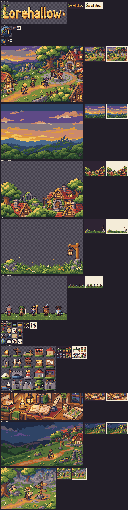

# Batch 02 report: Brand and website art

Generated by `make art-draw BATCH=02`. Do not edit by hand.
Hand-drawn assets are rendered from `art/src/`; generated ones come from
intake (`intake-report.md` has their details, when there are any).

Summary: 6 drawn, 7 generated

| Asset | Kind | Size | Source | Status | Problems |
|---|---|---|---|---|---|
| `logo_wordmark` | web | 192×64 | `art/src/web/logo_wordmark.py` | drawn |  |
| `emblem` | web | 32×32 | `art/src/icons/emblem.py` | drawn |  |
| `emblem_16` | web | 16×16 | `art/src/icons/emblem_16.pxl.yaml` | drawn |  |
| `hero_scene` | web | 240×160 | intake | generated |  |
| `parallax_far` | web | 240×160 | intake | generated |  |
| `parallax_mid` | web | 240×160 | intake | generated |  |
| `parallax_near` | web | 240×160 | intake | generated |  |
| `character_lineup` | web | 192×128 | `art/src/web/character_lineup.py` | drawn |  |
| `section_icons` | tileset | 64×64 | `art/src/icons/section_icons.pxl.yaml` | drawn |  |
| `progress_landmarks` | tileset | 160×128 | `art/src/web/progress_landmarks.py` | drawn |  |
| `devlog_header` | web | 240×80 | intake | generated |  |
| `og_card` | web | 240×126 | intake | generated |  |
| `not_found` | web | 160×120 | intake | generated |  |

Contact sheets: [4x, every asset](preview.png) and [8x, hand-drawn](preview-8x.png).
Each asset is also shown at 1x on dark and light backgrounds.

